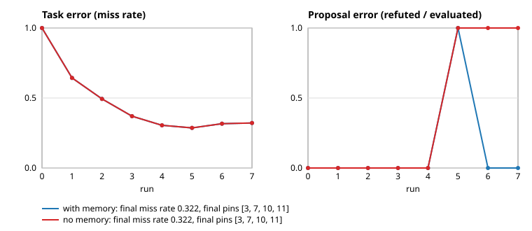

# Tuner: a small learning loop with receipts

`anomalon_workbench.tuner` is a library of five verbs that lets a system improve
from its own receipts without ever changing live behaviour on its own:

| Verb | Signature | Returns |
| --- | --- | --- |
| `propose(proposer, context, memory)` | typed `Candidate`s stamped with the proposer's name | list of candidates |
| `evaluate(evaluator, candidate, history)` | replay the candidate against recorded history | `Verdict`: `supported`, `refuted` or `underdetermined`, with its evidence |
| `authorize(authorizer, candidate, verdict, policy)` | apply a declared `Policy` | `Authorization`: `approved`, `denied` or `needs_human`, with a reason |
| `record(log, step, candidate, body)` | append to a hash-chained `ReceiptLog` | `Receipt` |
| `learn(receipts)` | fold refuted verdicts into a `MistakeMemory` | the memory |

`Loop` wires them together and enforces the rules the verbs rely on:

- **Three separate components.** `Loop` refuses to start when the proposer,
  evaluator or authorizer is the same object or carries the same name
  (`RoleConflict`). `authorize` raises `SelfAuthorization` when the authorizer
  is the candidate's origin or when an authorization names the proposer.
- **Nothing self-applies.** `authorize` turns any approval of a non-`supported`
  verdict into `denied`. `underdetermined` always goes to a human. The caller's
  `apply` callback only runs after `supported` + `approved`; a declared
  `max_applied_per_run` defers the rest with their verdicts on record.
- **Every step writes a receipt.** `proposed`, `skipped_known_mistake`,
  `evaluated`, `learned`, `authorized`, `deferred`, `applied`, `apply_failed`.
  Receipts are SHA-256 over canonical JSON including the previous hash;
  `ReceiptLog.verify()` returns the index of the first broken link and
  `replay(log)` rebuilds the applied set, the pending-human set and the
  mistake memory from receipts alone.
- **The same mistake is not proposed twice.** Every proposal is looked up in
  the memory first; a hit is recorded as `skipped_known_mistake` with the
  earlier reason and receipt number.

The module is standard library only (no numpy, no pydantic) so that another
project can vendor it verbatim and record the revision it copied.

## Demo: pinning keys in a tiny cache

```powershell
uv run python -m anomalon_workbench.tuner_demo --out docs/engine
```

Twelve keys are read with a skewed frequency and the cache can pin four. Each
run is a fresh 600-read segment of a recorded trace (seed 7). Before a run the
proposer suggests pin/swap changes ordered by last-run frequency, the evaluator
replays the previous segment, the policy approves changes that save at least
1 % of reads, and at most one change is applied per run. The demo is run twice,
with and without mistake memory.



| Run | 0 | 1 | 2 | 3 | 4 | 5 | 6 | 7 |
| --- | --- | --- | --- | --- | --- | --- | --- | --- |
| Task error (miss rate), both variants | 1.000 | 0.643 | 0.493 | 0.370 | 0.305 | 0.287 | 0.317 | 0.322 |
| Proposal error, with memory | 0 | 0 | 0 | 0 | 0 | 1.0 | 0 | 0 |
| Proposal error, no memory | 0 | 0 | 0 | 0 | 0 | 1.0 | 1.0 | 1.0 |
| Proposals skipped by memory | 0 | 0 | 0 | 0 | 0 | 0 | 32 | 32 |

Reading the numbers: the task error falls as the four hot keys are pinned one
per run (runs 1–4). From run 5 the cache is full and all 32 possible swaps are
refuted by replay. With memory they are skipped on runs 6 and 7 (receipts
`skipped_known_mistake`); without memory they are re-evaluated and re-refuted
every run. Memory changes how much evaluation work is wasted, not the task
error, and the demo says so. The miss rate from run 4 on is the floor for four
pins on this trace, not zero.

Outputs: [`demo_chart.svg`](demo_chart.svg), [`demo_receipts.json`](demo_receipts.json)
(360 receipts, chain intact), [`demo_summary.json`](demo_summary.json) with a
`replay` of the receipt log.

`tuner_demo.verify_receipts(log, trace)` recounts every `evaluated` receipt
from the recorded trace. It is the check that catches an evaluator that lies
(see the mutation tests below) and never consults the evaluator.

## Mutation tests (`tests/test_tuner.py`)

| Mutation | Expected detector | Caught | Fix | Re-check |
| --- | --- | --- | --- | --- |
| One receipt hash reversed | `ReceiptLog.verify()` / `replay` | yes, index 0, `ReceiptChainBroken` | restore the receipt | chain verifies, mutation re-caught |
| Receipt body edited, hash kept | `ReceiptLog.verify()` | yes, index 1 | — | — |
| Receipt deleted from the middle | `ReceiptLog.verify()` (prev_hash) | yes, index 1 | — | — |
| Proposer and authorizer share a name | `Loop` constructor | yes, `RoleConflict` | distinct names | — |
| Authorizer forwards approval to the proposer | `authorize` | yes, `SelfAuthorization` | — | — |
| Rubber-stamp authorizer approves a refuted verdict | `authorize` | yes, turned into `denied` | — | — |
| Mistake memory removed (`NullMemory`) | second run's `skipped_known_mistakes` | yes: refuted again, skipped 0 | restore memory | skipped 1 |
| Evaluator calls everything supported | `verify_receipts` recount, no `learned` receipts | yes | honest evaluator | audit returns `[]` |

## Limits

- Mistake memory is exact-match on `(kind, payload)` and does not expire. On a
  workload that drifts, a once-refuted candidate may become good; the memory
  must then be rebuilt from a bounded window of receipts (`learn` accepts any
  iterable of receipts) rather than the whole log.
- The loop is single-threaded and in-memory. Persisting the log is the
  caller's job (`ReceiptLog.dumps` / `loads`).
- Hashes bind receipt content to its predecessor; they do not prove the
  evaluator told the truth. That is what `verify_receipts`-style audits are for,
  and each application of the loop needs its own.
